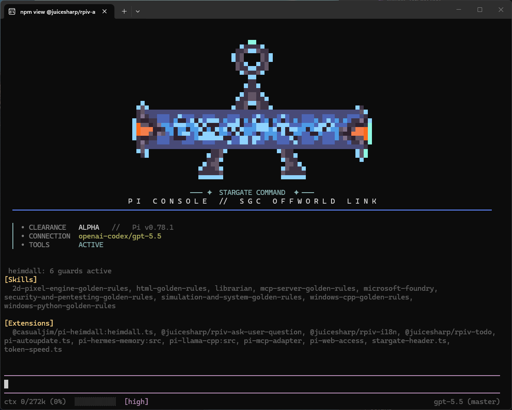

# Pi configuration (`~/.pi`)

Personal configuration for the [Pi coding agent](https://pi.dev): a custom
theme, seven local TypeScript extensions, lazily routed procedural skills, and a
few installed pi packages.



## Layout

```text
~/.pi/
├── README.md                  # this file
├── PLAN.md                    # current complex-task state
├── agent/
│   ├── settings.json          # global settings (provider, model, packages, theme)
│   ├── pix.json               # pix extension state/config
│   ├── heimdall.example.json  # portable example; real heimdall.json is OS-local
│   ├── agents/                # custom roles; model routing lives in settings.json
│   ├── prompts/plan.md        # lazy /plan workflow template
│   ├── skills/                # global reusable Pi skills
│   ├── projects-memory/
│   │   └── <project>/skills/  # project-scoped reusable Pi skills
│   ├── npm/
│   │   ├── package.json       # installed pi package manifest
│   │   └── package-lock.json  # installed pi package lockfile
│   ├── package.json           # editor-only devDependencies (see "Editor setup")
│   ├── tsconfig.json          # editor-only TS config (see "Editor setup")
│   ├── extensions/            # auto-discovered local extensions (*.ts)
│   │   ├── alarm-sound.ts
│   │   ├── autotuner.ts       # AutoTuner model gateway (provider + /autotuner)
│   │   ├── pi-autoupdate.ts
│   │   ├── post-edit-validation.ts
│   │   ├── subagent/config.json # native child concurrency/depth defaults
│   │   ├── skill-governor/    # metadata router and deterministic audit
│   │   ├── stargate-header.ts
│   │   └── token-speed.ts
│   ├── skill-governor/config.json
│   └── themes/stargate-sg1.json
```

Extensions placed in `~/.pi/agent/extensions/*.ts` are auto-discovered for all
projects and can be hot-reloaded with `/reload`.

## Local extensions

### `pi-autoupdate.ts`

Wraps Pi's own update mechanism so updates can be triggered from inside a
session (by you or by the model).

It delegates to the `pi` CLI rather than calling `npm` directly, because Pi
packages are not global npm installs — they live under `~/.pi/agent/npm/`,
`.pi/npm/`, and `~/.pi/agent/git/…` and are managed by `pi update`.

Command:

- `/update` — update Pi and all packages
- `/update self` — update Pi only
- `/update extensions` — update packages only
- `/update models` — refresh model catalogs (`pi update --models`)
- `/update check` — report whether a Pi (self) update is available

Tool (`pi_update`, callable by the model):

- `scope`: `"all"` (default), `"self"`, or `"extensions"`
- `check`: only check the Pi version, don't install
- `confirm`: deprecated compatibility field; ignored (authority is derived from the direct request)
- `force`: reinstall Pi even if current (only with `scope: "self"`)

A direct natural-language request such as “Pi und die Extensions aktualisieren”
authorizes exactly that scope for one model-tool call without a second popup.
“Nur Pi” and “nur die Extensions” cannot silently escalate to the other scope;
forced reinstall additionally requires explicit wording. Quoted examples,
meta-questions, conditional requests, and negations grant no authority. An
unrequested model update is blocked automatically—even if the model requests a
confirmation popup. Typing a valid `/update ...` command is itself explicit
authority; typos show usage instead of defaulting to a full update.

Version-pinned npm specs and pinned git refs are skipped automatically by
`pi update`, so the extension does not special-case them.

On Windows, package updates pause pi-intercom's detached broker and hold its
respawn lock while npm replaces packages. Cancellation propagates through
network checks and child processes; the broker working-directory patch is
re-applied before the lock is released, including after partial failures or
user cancellation. Since v3.4, the check also recognizes pi-intercom's upstream
`getIntercomDirPath(agentDir)` cwd and leaves its environment-aware behavior
unchanged. Legacy `extensionDir` launchers are still repaired; unknown or
ambiguous assignments fail visibly instead of being silently accepted.
It also preserves a Windows compatibility patch for
`pi-subagents`: async workflows use an independent UUID for their runtime
directory because Pi 0.84 tool-call IDs may contain the Windows-invalid `|`
character. The tracked `agent/npm/patches/postinstall.cjs` applies this fix
while Pi installs package dependencies, before the package is first loaded;
the update extension re-checks it only during an explicitly requested later
update. Since v2.6, the check also recognizes pi-subagents' native conditional
UUID assignment, so current safe releases no longer emit a false compatibility
warning. v3.1 also repairs pi-subagents' host-tool discovery when an extension
wraps a builtin (see below). Both install and explicit update use the same
tracked repair; unknown discovery implementations are reported as failures
rather than silently overwritten. Merely starting Pi performs no package-source
or OS-config mutation.

Since v3.5, the same install/update hook also repairs host-module declarations
in managed npm extension manifests: Pi's runtime modules belong in
`peerDependencies` with a `"*"` range, not `dependencies` or
`optionalDependencies`. This fixes the Hermes `pi-tui` and rpiv `typebox`
startup warnings and normalizes existing host-peer ranges. The repair covers
scoped and unscoped extension packages in user/project npm roots, is idempotent,
and leaves ordinary libraries, shared transitive installations, unrelated
runtime dependencies and optional-peer metadata untouched. The lockfile retains
upstream package metadata; `npm ci` reapplies the repair via postinstall before
first load. `/update` reapplies it after package replacement; `/update self`
does not touch extension manifests. There is no longer any llama-provider port
patch or `llamaServerUrl` rewrite.

#### Upstream-publish-bug resilience

Occasionally a package is published to npm with an unresolved `workspace:*`
dependency (a pnpm/yarn monorepo protocol that plain npm cannot resolve). When
that happens, `pi update`'s internal `npm install …@latest` fails with
`EUNSUPPORTEDPROTOCOL`, which aborts the **entire** package update — so one
broken upstream release blocks every other package too.

Before running `pi update`, the extension pre-flights the latest version of
each declared npm package against the public registry. Any package whose latest
version still carries a `workspace:` dependency is treated as "do not update":
the extension updates the remaining packages individually (`pi update
npm:<pkg>`) and skips the broken one, keeping its currently-installed (good)
version. This is self-healing — once the author publishes a fixed version the
pre-flight finds nothing broken and the normal bulk update resumes. The
pre-flight is fail-open (offline / custom-registry / errors never block
updates). It was added after `@xynogen/pix-optimizer@1.1.14` shipped
`"@xynogen/pix-data": "workspace:*"`.

### `alarm-sound.ts`

Plays the configured MP3 when Pi finishes, `ask_user_question` waits for input,
or any extension opens a yes/no confirmation. Permission selectors such as
MCP/RTK allow-or-deny dialogs are detected as well; ordinary menus do not ring.
The wrapper is shared across extensions and deduplicates an already-running
alarm. Use `/alarm-sounds on|off|test|status` to control, test, or diagnose it.

### `autotuner.ts`

Switches local models through [AutoTuner](https://github.com/DaWasteh/Auto-Tuner)
instead of talking to `llama-server` directly. AutoTuner's opt-in control API
(**⋯ → Settings → External control API**, loopback port 1233 by default) owns the
serialized stop/configure/start/health-check transition and keeps every saved
per-model launch setting; the extension only asks for a model ID.

- **Provider `autotuner` in `/model`.** The extension registers the provider
  with the models AutoTuner scanned (`GET /v1/models`), so every runnable GGUF
  appears under provider **AutoTuner** in Pi's native selector. Opening `/model`
  refreshes the catalogue through Pi's `refreshModels` hook; Pi's offline
  startup refresh returns the known list without touching the network.
- **Pre-switch with a status line.** Selecting an AutoTuner model in `/model`
  sends `POST /api/v1/switch` immediately and shows a `⏳ AutoTuner lädt …` status until
  llama-server answers `/health`, then notifies how long the load took. The
  `before_provider_request` hook repeats that idempotent switch whenever the
  request's model differs from the last confirmed one, so a restored session or
  a `/model provider/id` argument never hangs silently for minutes. Restored
  sessions are not pre-warmed on their own; the first request loads the model.
- **`/autotuner`.** Without arguments it opens an interactive switcher built
  from `GET /api/v1/models`, marking the active model (●), runnable ones (○), and
  non-runnable entries (✗) with AutoTuner's reason. `status`, `models`,
  `switch <id>`, `stop`, `runtimes`, `refresh`, `health`, and `help` are the
  subcommands; a successful switch also activates the model in Pi. `runtimes`
  lists the llama-server builds AutoTuner knows (● active, ◆ toolbar default);
  the toolbar selection itself is left to the user, so switches never pass a
  `runtime_id`. Each switch states AutoTuner's documented 900-second health
  wait explicitly (`timeout_s`) and the client waits slightly longer, so a slow
  load is reported by the gateway's `switch_timeout` rather than a socket error.
- **Credentials.** Environment (`AUTOTUNER_API_URL` + `AUTOTUNER_API_KEY`, or
  `AUTOTUNER_CONTROL_API_PORT`/`AUTOTUNER_CONTROL_API_KEY`) wins, then the
  `control_api.json` sidecar AutoTuner ≥ 5.3.9 writes next to its settings,
  then a regex scan of `autotuner_settings.json`. That file holds benchmark
  results and is tens of megabytes here, so it is never JSON-parsed; AutoTuner's
  reference extension refused files above 2 MiB and could not find the token on
  this machine at all. Since v2.9 the sidecar is authoritative only while it
  carries a token: AutoTuner rewrites it as `enabled: false` without a token
  whenever the gateway stops (app closed, API switched off, a second instance
  exiting), and that used to hide the credentials that were still persisted in
  the settings file. Now the settings file decides in that case and the request
  itself reports "nicht erreichbar"; only a persisted `control_api_enabled:
  false` (or `AUTOTUNER_CONTROL_API_ENABLED=0`) is a veto.
- **AutoTuner may start after Pi.** Credentials are re-read whenever `/model`
  opens while the provider is unconfigured and on every session start, and the
  provider is re-registered with the real token right after the refresh, so no
  Pi restart or `/autotuner refresh` is needed once AutoTuner is running.
- **Unload on quit.** A model that this Pi process loaded through the gateway is
  stopped again (`POST /api/v1/stop`, bounded to 10 s) when Pi quits. Session
  switches (`/new`, `/resume`, `/fork`, `/reload`) keep it, a model that was
  already running before Pi asked for it (started from AutoTuner's GUI or by
  another client) is never touched, AutoTuner's `model_busy` answer for in-flight
  requests is respected, and `AUTOTUNER_UNLOAD_ON_EXIT=0` disables the behaviour.
- **Reasoning.** Pi-level `reasoning` mirrors AutoTuner's scanner verdict so
  `reasoning_content` renders as thinking blocks. No `reasoning_effort` is
  sent because AutoTuner's saved reasoning launch setting decides whether the
  model thinks at all. Chat traffic goes through AutoTuner's OpenAI proxy on
  port 1233; llama-server itself keeps listening on 1234.
- **No artificial token limits (v3.3).** AutoTuner's catalogue advertises a
  fixed `max_tokens` of 16,384 that reasoning and the answer would share; three
  local test runs ended with 16,384 tokens of pure thinking and "Response was
  truncated before completion." The provider now uses the whole context window
  as the ceiling and pi-ai sizes `max_tokens` from the remaining context on
  every request, so a model may use its natural context. Pi's thinking level is
  not a hard cut either: llama-server's `thinking_budget_tokens` closes the
  thinking block once spent, so the level's budget (`thinkingBudgets` in
  settings) is rewritten into a request at the end of the system prompt
  ("aim to stay within about N reasoning tokens, take the room a problem
  genuinely needs"). Only a safety net stays hard: 8,192 tokens before the end
  of the response the thinking block is closed so a runaway reasoning phase
  still ends in an answer instead of a truncated one. Level `max` gets the
  safety net only. `AUTOTUNER_THINKING_BUDGET=hard` keeps llama-server's hard
  cut at the level's budget, `=off` sends no budget field at all.

When the API is off or AutoTuner is closed, the provider registers empty and
stays quiet; `/autotuner status`, `/autotuner health`, and a startup warning
(only while an AutoTuner model is the active model) explain what to enable or
that the gateway is not reachable. `AUTOTUNER_DATA_DIR` moves the
settings and sidecar lookup for portable installs.

### `stargate-header.ts`

Replaces the startup header with an open Stargate Command console banner
(chevron crown, rounded gate ring with an event-horizon beam, A-frame stand).
Width-adaptive and re-rendered live on theme, model, skill, and extension
changes.

Commands:

- `/header` — toggle between full and quiet mode
- `/refresh-header` — re-scan skills and extensions

### `token-speed.ts`

Custom footer showing context usage with a progress bar, measured generation
speed (tokens/second), the active thinking level, and estimated thinking and
output token counts, with the model and git branch right-aligned.

### `post-edit-validation.ts`

Uses Pi 0.84.4's native `tool_result` event to collect successful `write` and
`edit` paths, then validates the final batch at `turn_end` after parallel tools
settle. Checks are deterministic and check-only: JSON parsing, skill audit,
TypeScript `--noEmit` through the trusted agent compiler when a config exists,
Node syntax, and optional Python/PowerShell/shell parsing. It never executes an
edited test/module, package install, formatter-write, generic full suite, or
network operation.

All in-process checks run; grouped TypeScript checks take priority within an
eight-command external-validator ceiling. Any overflow is an explicit failure
listing unvalidated files, never silent success. Success is silent. A failure is
persisted and delivered to the next model turn as bounded structured negative
feedback. At most two automatic repair-feedback rounds are sent per user turn;
further failures stop the loop and remain visible as status/evidence.

Since v2.8 the validator is honest about its own limits: a validator killed by
its 30-second timeout is a failure, not a pass, and a non-zero exit with no
output at all (Pi's `exec` never throws for a missing executable) is treated as
an unavailable runtime and skipped. External validators run three at a time
instead of serially. JSON-with-comments files (`tsconfig*.json`,
`jsconfig.json`, `.vscode/*.json`, `*.jsonc`) are not parsed strictly.
TypeScript diagnostics list the edited files first and label diagnostics from
other files as possibly pre-existing, capped at eight lines, so the repair loop
cannot be hijacked by unrelated project errors. Only a real `SKILL.md` triggers
the skill audit, `.sh` files use Git Bash explicitly on Windows, and the
feedback message truncates per validator so its round-limit instruction and
closing tag always survive.

### `skill-governor/`

A lean metadata router, not an authority or sandbox. It ranks every current-scope
skill—including manual skills—without loading bodies. Cloud prompts receive at
most three matching descriptions; interactive local models receive one to keep
the system-prompt string under the measured budget. A selected manual skill is
made normally readable; reading instructions grants no additional authority.

The small `capability_route` tool searches hidden skill metadata and, only in an
interactive local profile, tools that this Governor itself removed. It never
enables a tool that was already inactive or blocked. Returned descriptions are
bounded to 320 characters. Interactive llama.cpp/AutoTuner/Ollama/LM
Studio/vLLM/SGLang sessions initially expose only configured core tools plus
`capability_route`; cloud and headless sessions keep their configured tools and
Pi's full prompt. `/skill-governor` provides read-only status, search, and file
audit. There is no automatic LLM evolution, candidate store, active-skill read
blockade, shell parser, or confirmation UI, and the Governor never asks the
user anything: it only reduces what a local model sees and routes lazily.

v2.8 tightened the lexical router after a review reproduced false routings with
the real 85-skill catalogue: a bare substring of a skill name no longer scores
("ok" inside "smoke", "ui" inside "comfyui"), two-character tokens cannot route
a skill on their own, and generic verbs such as "fix", "repair", or "mach
weiter" are stop words. Local detection recognizes the `autotuner` provider and
anchors loopback origins (`127.0.0.1`, `localhost`, `0.0.0.0`, `[::1]`, `[::]`)
so `http://localhost.example.com` is not local. `config.json` is validated
field by field, `maxSkillsLocal` fills the byte budget with as many compact
descriptors as fit, and the governor-owned tool delta is persisted as a session
entry so `/reload` no longer loses the ability to restore hidden tools on the
next cloud switch. The 900-byte bound covers the Governor's own output; package
extensions that run later (Hermes memory policy, pix-optimizer modes) append
their fragments afterwards and own that cost.

With installed Pi 0.84.4 and the current `.pi` scope, the native automatic-skill
prompt measured 7,924 characters (about 1,981 via coarse `chars / 4`). Ordinary
local sessions now replace that boilerplate with a read-first prompt and one
compact, untruncated metadata record only when the complete UTF-8 string remains
at most 900 bytes. This leaves framing margin while conservatively staying below
1,000 tokens for the target byte-based tokenizers; skill bodies remain lazy. An explicit CLI
`customPrompt`/`appendSystemPrompt` has higher precedence and is never truncated;
tool schemas and chat framing are separate provider input. The old v2.4 model
benchmark was not rerun or relabeled as v2.7 evidence.

## Complex work and session branches

Invoke `/plan [objective]` for work with at least three dependent steps or a
likely compaction/session boundary. The lazy prompt creates or resumes root
`PLAN.md`, keeps exactly one step active, and records verified decisions,
checks, and blockers. Small tasks skip the file.

Use Pi's native `/tree` to explore an alternative from the last sound decision;
update `PLAN.md` and inspect `git status` first because conversation branches do
not restore shared files. `/fork` or `/clone` creates a separate session, not a
filesystem worktree. Concurrent writers therefore require isolated worktrees;
otherwise keep one writer.

## Installed packages

Declared in `settings.json` (and/or user settings). See each package upstream
for details:

- `pi-mcp-adapter`, `pi-web-access` — MCP and web tools
- `pi-hermes-memory` — durable memory policy/store
- `pi-subagents`, `pi-intercom` — child-agent and peer-session coordination
- `@juicesharp/rpiv-{todo,i18n,ask-user-question}` — task/UI helpers
- `@casualjim/pi-heimdall` — platform sandbox integration
- `@gaodes/pi-graphify`, `@xynogen/pix-optimizer` — graph and prompt/context helpers
- `pi-prompt-template-model` — prompt-template model selection
- `pi-goal-x` — explicitly requested persistent goals

The current installed package manifest is also tracked in
`agent/npm/package.json` / `agent/npm/package-lock.json` so the repository
reflects the package set managed by `pi update`.

## Heimdall sandbox and OS-local state

Heimdall's sandbox uses Linux `bubblewrap`. Since `@casualjim/pi-heimdall` 0.3.32,
Heimdall stores user config universally in `~/.config/heimdall/config.json` (and
defaults `sandbox.enabled` to `false` in `~/.config/heimdall/default.jsonc`),
migrating and deleting legacy `agent/heimdall.json` automatically. The bundled
`pi-autoupdate.ts` extension detects whether the installed Heimdall uses the
universal config directory or legacy `agent/heimdall.json` and keeps it aligned
with the current OS:

- Linux: `sandbox.enabled = true`
- Windows: `sandbox.enabled = false`
- macOS: `sandbox.enabled = false` until Heimdall supports a macOS sandbox

This prevents Windows/Linux/macOS checkouts from constantly dirtying Git with an
OS-specific config flip. `agent/heimdall.example.json` documents the portable
shape of the config.

Other local runtime files are ignored too, including generated Heimdall defaults,
`agent/models-store.json`, mission indexes, run history, intercom/session state,
SQLite lock databases (including WAL/SHM sidecars), Hermes memory databases, and
project `MEMORY.md` files. Credential files, private keys, certificates, tokens,
and environment files are excluded defensively as well.

## Published skills

Reusable Pi skills are intentionally tracked because they can help other users
even on different systems:

- `agent/skills/**/SKILL.md` — global skills
- `agent/projects-memory/*/skills/**/SKILL.md` — project-scoped skills

Only the skill files are published; private memory files and session databases
remain ignored.

A project skill is only ever routed when its `projects-memory/<key>` folder
equals the basename of the git top level (or the working directory) of the
session. v2.8 audited all 85 skills against that rule and the machine's real
paths: 20 skills lived under keys that could never match (the retired
`DaWasteh ComfyUI Nodes` clone, `Goa'uld Translator`, `llama-mcp-server`,
`PyTank`, `GitHub`) and were moved to `DaWastehs-ComfyUI-Bundle`,
`Goauld Translator`, `llama-mcp`, `Python-Games-Collection`, or the global
skills. Five completed one-off migrations and tool-less skills were retired to
the ignored `agent/skill-governor/retired/` folder. Stale roots (`H:/ComfyUI`,
`C:\LAB`, the `DaWasteh - Neu` workflow folder) were corrected, and the
identical 500-byte governance paragraph plus the two boilerplate description
tails ("Manual-only: invoke only for…", "Do not use for unrelated project
work…") were shortened in 61 files. The tails were 30 % of all description
bytes, produced measurable routing noise for everyday words, and pushed six
skills over the local 900-byte budget. Skill bodies are still lazy and
untouched otherwise; merging the overlapping live-avatar and YuE skills remains
a manual editorial task.

## Theme

`stargate-sg1` — an amber/orange SGC terminal palette. Selected via
`"theme": "stargate-sg1"` in `settings.json`. The theme file references a
remote `$schema`; VS Code may warn that the schema URL is "untrusted" and skip
download. That is cosmetic and does not affect Pi, which validates themes
itself.

## Settings

Key fields in `agent/settings.json`:

- `defaultProvider` / `defaultModel` — the provider and model used on startup
- `packages` — installed pi packages
- `theme` — active theme name
- `compaction` — context compaction thresholds
- `thinkingBudgets` / `defaultThinkingLevel` — reasoning token budgets per level
- `subagents` — central role-to-model routing and local fallback policy

Compaction reserves 32,768 tokens and keeps the most recent 32,768. The former
131,072-token keep window exceeded Pi's 128,000-token llama fallback threshold
once the reserve was subtracted, so it could not reliably free context. Durable
task state belongs in `PLAN.md`, not an oversized recent-message tail. Thinking
budgets use Pi's documented 1,024 / 4,096 / 10,240 / 32,768 progression instead
of the former 2,048 / 8,192 / 32,768 / 65,536 allocation.

### Local model profile

The router recognizes local provider IDs/loopback URLs rather than hard-coding
unavailable model aliases. Public checkpoint/API names verified for this release
are `Qwen/Qwen3.8-27B`, `Qwen/Qwen3.8-Flash-Next`,
`google/gemma-4-31B-it`, and Mistral's `mistral-medium-3-5`; llama.cpp model IDs
remain whatever `/v1/models` actually exposes. Qwen aliases currently present in
`modelThinkingLevels` use medium reasoning. Other aliases are not invented while
the local server is offline.

All local families share the same short tool discipline: schema-valid arguments,
real tool results as ground truth, and correction of validator errors before a
success claim. No source reviewed for v2.7 established a reliable
family-specific prompt advantage, so separate Gemma/Mistral/Qwen prose profiles
would add unsupported complexity.

Local models are selected exclusively through the independent `autotuner`
provider (see `autotuner.ts`). v3.5 removes the redundant `pi-llama-cpp` Pi
extension, its direct-provider thinking aliases, `llamaServerUrl`, and the
updater's fallback-port patch. This removes the unreachable-server startup
warning and the second model/control path. AutoTuner's model catalog, loading,
readiness checks, proxy, runtime selection and thinking budgets are unchanged.
**llama.cpp itself remains required** and continues to be managed by AutoTuner.

### Global engineering guideline: Ponytail

`pix.json` now starts every session with pix-optimizer's **Ponytail** mode at
level `full` (the "lazy senior developer" ruleset adapted from
DietrichGebert/ponytail): stdlib and native features first, no speculative
abstractions, the shortest diff that works, deliberate shortcuts marked with a
`ponytail:` comment, and explicit safety floors that must never be simplified
away (validation at trust boundaries, error handling that prevents data loss,
security, accessibility, one runnable check for non-trivial logic). The runtime
toggle `/optimizer ponytail <level>` still persists overrides to
`optimizer.json`.

This matches the research the extensions are built on. The empirical study of
skill-induced failures found that most cost regressions come from excessive
procedure (mandatory verification checklists, heavy pipelines) and always-loaded
skill text rather than from irrelevant skills; the misevolution and WikiSkill
work show that persistent procedures need short, inspectable bodies with
explicit safety floors. Ponytail encodes exactly that trade-off for the code
the agent writes, and it lets the agent default instead of asking when a
question is not genuinely needed. For interactive local sessions the Governor's
compact prompt already carries the "smallest complete safe change" rule; the
full Ponytail fragment is appended by pix-optimizer after it, which is the one
deliberate exception to the local byte budget.

### Subagent model hierarchy

The parent orchestrator starts on **GPT-6 Astra High**. v3.0 removes Spark
from automatic routing and uses central role settings rather than per-run model
pins. This is an operator-selected quality/context policy, not a measured model
quality or pricing benchmark.

| Tier | Intended work | Roles |
| --- | --- | --- |
| GPT-6 Astra High | Leadership, actionable plans, architecture decisions, critical review | `teamleiter`, `planner`, `oracle` (alias `advisor`), `reviewer`, parent |
| GPT-5.6 Sol High | Reproduction, regression analysis and difficult root causes | `bugtester` |
| GPT-5.6 Terra Medium | Implementation, focused repairs, substantial research and general delegation | `worker`, `mechanic`, `researcher`, `delegate`, unclassified native roles |
| GPT-5.6 Luna Low | Focused repository recon and primary-source web evidence | `scout`, `web-searcher` |

The active Codex registry on this installation reports **272,000 context tokens**
for Astra and all three 5.6 models, versus Spark's **128,000**. These are context
windows, not guaranteed input allowances: prompts, tool definitions, history and
output need room too. No context-limit overrides or priority `fast` tier are
configured. Spark remains selectable manually for tiny self-contained work, but
is neither the default nor a fallback.

Workers and evidence roles start fresh with a compact goal/cwd/ref/files/acceptance
handoff rather than automatically inheriting the entire parent conversation.
`oracle` keeps its fork preference for decision consistency; an explicit fork is
still available when history matters. Large-context models still need bounded
retrieval and checkpoints. Parent `modelThinkingLevels` preferences remain
separate from explicit child-role thinking.

`planner` is now a real read-only agent, not just a settings entry. The old
`context-builder` entry never defined an executable role and was removed; use
`scout`. Custom roles use Pi's base prompt plus their short specialist contracts,
keep project instructions and have no mandatory RTK prefix. The web-searcher has
no shell or file-write tools, can selectively use `source_check`, and searches
with `workflow: "none"` to avoid interactive curator waits. It must not invent
access dates or label versioned archives as the latest documentation. Bugtester
may execute bounded read-only/test commands; its `bash` access is **not a sandbox**. Mechanic stays a single scoped writer with regression tests.
Publication and unresolved architecture/product decisions remain with the parent.

The teamleiter handles small tasks directly, plans up to two useful independent
analysis paths, or synthesizes completed reports with original-source checks.
**Only the root parent launches employees** through a native async workflow with
unique stable child `key` fields and central role routing. Await evidence before
handing it to the teamleiter; a launch acknowledgement is not a completed report.
The teamleiter has neither shell nor subagent tools. Runtime limits live in
`agent/extensions/subagent/config.json`: four concurrent children **per workflow**,
twelve cumulative launches **per run tree**, two active top-level async runs
**per session**, depth one. These are defaults, not machine-wide quotas;
explicit workflow limits can override defaults and inherited stricter ceilings
remain authoritative. Existing runtime deadlines, supervision and tool checks
are retained.

#### v3.1: builtin wrappers and child tool discovery

pi-subagents 0.67.0 filtered the host registry by `sourceInfo.source` being
`builtin` or `auto`. Heimdall registers a same-name `bash` wrapper even when its
sandbox is disabled, and Pi correctly reports that tool's extension provenance.
The filter therefore omitted a working shell: scouts failed before launch with
`host runtime does not provide permitted required repository tools [bash]`;
other shell-using roles could silently lose it. A second bug applied that
builtin-only host list to every declared tool, silently stripping `web_search`,
`fetch_content`, `source_check` and `get_search_content` from web children.

The compatibility repair in `agent/npm/patches/postinstall.cjs` checks **registered
canonical builtin names**, not provenance, and limits host pruning to those
builtin names. Declared extension tools survive that filter but still need their
provider loaded in the child. It does not invent absent builtins, forward parent
implementations, enable undeclared extension tools, remove `excludeTools`/capability
ceilings, or disable strict required-child-tool validation. Heimdall,
model routing, the flat team and concurrency/depth limits remain unchanged.
Regression tests cover both omissions, wrapped/SDK tools, absent builtins,
declared extension/coordination tools, idempotence, CRLF and unsupported upstream
layouts. Both source repairs are validated before modifying the package.

After applying the repair, run **`/reload` in each already-running parent Pi
session** before launching more children; changing files does not replace its
cached modules. A restart is the alternative. Fresh installs run the patch via
postinstall, and explicit package updates reapply it. To repair an existing
installation without updating any package, run `node agent/npm/patches/postinstall.cjs`
from this repository and then reload.

Release validation: 72 tests and typecheck pass; skill lint reports no errors.
A lockfile-integrity-verified pristine 0.67.0 package patches successfully and
remains unchanged on the second pass. Native async scout shell/read and web
fetch/menu smoke tests pass, and independent Astra review found no blockers.
The runtime dependency audit still reports **two pre-existing findings**:
`hono` 4.13.1 (moderate) and `smol-toml` 1.7.0 (high). The v3.0 lockfile produces
the same findings; this scoped repair does not remediate them. The editor-only
production audit reports zero findings.

#### v3.6: Pi 1.6.0 compatibility, updater repairs, and local/cloud skill polish

Align all local extensions, tests, editor/SDK declarations, theme schema, and
skills with **Pi 1.6.0** and the current installed extension packages
(`pi-subagents` **0.89.2**, `pi-web-access` **0.48.0**, `pi-mcp-adapter`
**7.0.1**, `pi-hermes-memory` **0.11.0**, `pi-intercom` **0.18.1**,
`@casualjim/pi-heimdall` **0.3.32**, `@xynogen/pix-optimizer` **1.3.14**,
`@juicesharp/rpiv-*` **2.15.0**, `pi-goal-x` **0.34.1**).

- **Updater & postinstall (`/update`, `pi-autoupdate.ts`, `postinstall.cjs`)**:
  - Recognize `pi-subagents` 0.89.2's `workflowResumeLaunch?.presetRunId ?? randomUUID()`
    assignment as filesystem-safe instead of throwing an unsupported-assignment
    error during `postinstall` or `/update`.
  - Recognize `@xynogen/pix-optimizer` 1.3.14's native
    `@xynogen/pix-runtime/binaries` (`resolveTool("rtk")`) resolver instead of
    failing the legacy `which`-probe check.
  - Align Heimdall sandbox handling with `@casualjim/pi-heimdall` 0.3.32's
    universal `~/.config/heimdall/config.json` path (avoiding recreation of the
    migrated/deleted legacy `agent/heimdall.json`).
  - Fix Pi 1.5+/1.6.0 `StringEnum` scope narrowing in `pi_update` and add
    `/update models` (`pi update --models`).
- **Post-edit validation (`post-edit-validation.ts`)**:
  - Keep the PowerShell literal-path parser fix (`powerShellParseArgs`) so paths
    with spaces, quotes, or metacharacters parse safely without unbound `$args`.
  - Recognize Pi 1.5+/1.6.0's `spawn <cmd> ENOENT` stderr signature as an
    unavailable optional runtime instead of injecting false validation failures.
  - Cap validator output via Pi 1.5+'s `maxBuffer` (2 MiB), treat `truncated`
    results as explicit failures, and skip files deleted before `turn_end`.
- **Skill Governor, footer, header, alarm & theme**:
  - Handle Pi 1.2+'s `BeforeAgentStartEvent` union (`"user"` vs `"custom"`) in
    `skill-governor/index.ts` so extension-triggered turns compile cleanly and
    never route spurious skills.
  - Map Pi's `max` thinking level to `thinkingMax` in `token-speed.ts`, ignore
    aborted `agent_settled` runs in `alarm-sound.ts`, use `getAgentDir()` in
    `stargate-header.ts`, and update `themes/stargate-sg1.json` to the Pi 1.2+
    schema (`https://pi.dev/schemas/theme.schema.json`) with fullscreen
    scrollbar/search and `thinkingMax` tokens.
- **Skills & hygiene**:
  - Add missing governance metadata and negative triggers to the 7 new project
    skills (`GitHub/refresh-windows-app-builds` and 6 `Half-Life 3` skills).
  - Tighten descriptions on 3 oversized project skills so all **101** skills fit
    within the 900-byte local prompt cap even on 60-character working paths.
  - Refresh `pi-model-routing`, `amd-dual-gpu-inference`, `pandaking-system`,
    `mcp-server-golden-rules`, `github-actions-pages-release-workflow`,
    `troubleshoot-github-pages-readme-instead-of-app`, and
    `validate-local-pi-extensions` for Pi 1.6.0 and local AutoTuner + cloud AI.
  - Ignore volatile runtime markers (`agent/mcp-last-seen-version.json`,
    `agent/mcp-onboarding.json`, `agent/pi-subagents/`, `agent/pi-web-access/`)
    and strip machine-local `deviceId` from tracked `agent/settings.json`.
- **Security & validation**:
  - `npm --prefix agent/npm audit fix` resolves 11 of 12 transitive runtime
    advisories (eliminating 1 critical `proxy-addr`, 4 high `body-parser`,
    `brace-expansion`, `undici`, `zod`, and 6 moderate findings); only upstream
    `minimatch` inside `pi-prompt-template-model` remains (requires breaking
    downgrade, intentionally not forced). `agent` devDependencies audit clean
    (0 vulnerabilities).
  - **101 unit tests**, `tsc --noEmit` against Pi **1.6.0**, `skill:lint`
    (**101 skills, 0 errors**), isolated loading of all 7 local extensions, and
    `npm run test:installed` against both the local SDK and global Pi **1.6.0**
    (**21 entry points, 51 tools, 0 errors/warnings**) all pass.

#### v3.5: AutoTuner-only local models and warning-free host peers

Remove `pi-llama-cpp` from Pi settings, the runtime manifest and lockfile;
remove its stale settings/thinking aliases and all updater port-1234 patches.
The separate AutoTuner provider remains intact; no llama.cpp binary or
AutoTuner configuration is removed.

Fix the Hermes `@earendil-works/pi-tui` and rpiv todo/questionnaire `typebox`
manifest warnings with a shared tracked postinstall/update repair. Host modules
are wildcard peers, not bundled runtime dependencies. Ordinary library
manifests are not rewritten. Preserve Windows intercom maintenance locking,
recovery-before-unlock, cancellation, subagent compatibility checks, pix,
Hermes notification and Heimdall repairs.

Capture the already-installed `pi-mcp-adapter` **3.3.0**, `pi-subagents`
**0.73.1**, `pi-web-access` **0.34.0**, and Pi settings **0.99.1**. Align
editor/test SDK dependencies to Pi **0.99.1**. Include the pending Math
Predictor calculator-only skill with the manual/high-risk governance metadata
required by skill lint; its procedure is unchanged.

Validation: **92 unit tests**, typecheck and skill lint (zero errors) pass.
Both the local SDK and global Pi **0.99.1** load all **21 extension entry
points**, expose **49 tools**, and pass startup/reload/shutdown with **no
extension package warnings or lifecycle errors**. An isolated lockfile-driven
`npm ci` runs the real postinstall hook and a second pass changes nothing.
Fresh updater tool and slash-command tests use a stub Pi executable: they
repair global/project manifests without restoring llama settings, while self
updates leave manifests alone. No real package upgrade or live GPU/model run
is performed as a test; the AutoTuner tests use a recording fake gateway.
The SDK smoke can emit pi-subagents' separate conservative host-verification
notice (it keeps delegation available); this is not an extension load failure.

Additional npm audit: the runtime tree still has five findings (three moderate,
two high: brace-expansion, fast-uri, ip-address, undici and its pi-subagents
parent); the editor tree has one high brace-expansion finding. No forced
package downgrade or unrelated security migration is included in this release.
Run `/reload` or restart Pi to unload the removed provider and refresh package
warnings; `node agent/npm/patches/postinstall.cjs` repairs an existing checkout
without upgrading any package.

#### v3.4: Recognize pi-intercom's upstream update-safe launcher

The npm update completed successfully, but `/update` reported failure during
its post-update and recovery checks. pi-intercom **0.15.0** already uses a safe
runtime working directory through `getIntercomDirPath(agentDir)`; our check
only recognized `getIntercomDirPath()` or the old `extensionDir` assignment.
The updater now recognizes both safe forms without rewriting them, preserving
upstream's environment-specific agent directory. Legacy launchers are still
patched idempotently, and unknown or multiple cwd assignments fail closed.
Windows broker pause, lock heartbeat, cancellation and recovery-before-unlock
remain unchanged.

This release also includes all pending package/configuration changes:
`@casualjim/pi-heimdall` **0.3.10**, `pi-goal-x` **0.31.9**, `pi-intercom`
**0.15.0**, `pi-llama-cpp` **0.15.0**, `pi-mcp-adapter` **3.0.0**,
`pi-subagents` **0.72.1**, `pi-web-access` **0.32.0**, their lockfile updates,
and Pi's recorded changelog version **0.87.1**.

Validation: **86 unit tests** and typecheck pass. Seven new regressions cover
upstream/legacy cwd forms, CRLF, spacing, idempotence, misleading comments,
unknown implementations and ambiguous assignments. The real freshly loaded
`/update` handler completed successfully on Windows with Pi **0.87.1**, all
post-update checks passed, and the maintenance lock was released. Installed
extension smoke passed for **22 entry points / 49 tools**, including
startup/reload/shutdown and read-only coordination tools. Its standalone SDK
harness emitted a non-blocking pi-subagents host-verification warning; no
LLM calls or child-agent launches were exercised. Both production dependency
audits report **zero vulnerabilities**. Skill lint: **0 errors, 25 warnings**.

Run **`/reload`** in existing Pi sessions to load the repaired updater; restart
Pi to ensure all newly installed package versions are loaded.

#### v3.3: Natural context for AutoTuner models

Three local model tests (Agnes 3.0 Flash, Qwen3.8-27B via the AutoTuner
provider) ended in "Response was truncated before completion." during
thinking. Cause: AutoTuner's catalogue reports a fixed `max_tokens` of 16,384
per model, the extension passed it on as the response ceiling, and no thinking
budget reached llama-server, so every response was 16,384 tokens of reasoning
with no answer or tool call (stopReason `length`).

The provider now ignores AutoTuner's `max_tokens` and uses the context window
as the ceiling; pi-ai already clamps `max_tokens` to the remaining context per
request. Pi's thinking level is delivered as a soft request in the system
prompt instead of llama-server's hard `thinking_budget_tokens` cut, with a hard
safety net only 8,192 tokens before the end of the response.
`AUTOTUNER_THINKING_BUDGET=hard|off` selects the old cut or no budget at all.
Details under **Local models through AutoTuner**.

Validation: 79 unit tests and typecheck pass; the request shape was verified
against a recording fake server (pi-ai sends `max_tokens` clamped to the
context plus the level budget, the hook rewrites it). No live llama-server run
in this release. Unrelated Half-Life/Godot skill and settings edits remain
outside this release.

#### v3.2: Pi 0.86.1 and compiled extension packages

Validated against the latest published Pi **0.86.1** and pi-subagents **0.70.0**.
The updater's “pi-subagents was not found” message was a detection bug, not a
missing installation: since 0.68 the npm package ships compiled `.js` instead
of `.ts`. Update and postinstall now share the same resolver, prefer executable
JavaScript, support legacy TypeScript checkouts, and never mistake `.d.ts` or
source maps for executable files. A present package with an unknown layout or
UUID implementation fails visibly instead of being reported as absent/safe.

Current upstream resolves tool availability inside the child. The compatibility
check recognizes that implementation and leaves it untouched; it does not
reintroduce the obsolete host filter. Legacy 0.67 repairs remain supported.
Tests cover both layouts, JS precedence, missing files, CRLF, idempotence,
unsupported implementations, and preservation of ceilings/exclusions.

Editor/test dependencies are pinned to Pi 0.86.1 (previously the local lockfile
still tested 0.84.4). Both the local SDK and the globally installed Pi passed
`npm run test:installed`: all **22 extension entry points** (seven local,
fifteen from fourteen external packages), **47 registered tools**, startup,
reload, shutdown, read-only subagent/todo/goal/intercom calls, and the actual
compiled child tool planner. **78 unit tests and typecheck pass.** This is not
an end-to-end test of every remote provider, interactive dialog, or LLM child
launch; the integration smoke makes no LLM calls and launches no agents.

The two previous npm audit findings are fixed with compatible transitive
updates: `hono` **4.13.8** and `smol-toml` **1.8.0**. Both tracked dependency
sets audit clean. Release-snapshot skill lint has no errors; unrelated local
Half-Life/Godot skill edits are excluded from this release.

Restart Pi after its core update; `/reload` suffices for extension-only changes.
Windows `EPERM` cleanup warnings about an old native console/clipboard DLL can
occur while older Pi processes still hold it open. They do not mean the newly
installed version failed to load; avoid deleting loaded DLLs or killing other
sessions merely to silence cleanup warnings.

#### Migration and validation

Live validation caught two nesting failures: an agent omitted the required
`runs.all` keys; after correction, its nested async runner disappeared before
returning results. The owner chose the **flat native team** rather than relying
on that failing lifecycle path. v3.0 does not claim to fix upstream nested async
execution; it does not use it. If nesting is reintroduced later, validate its
full completion lifecycle first, not just successful launch. The v3.0 nesting
investigation used no CLI/foreground fallback or package-source patch; v3.1's
separate discovery repair above does not change nesting.

A legacy `~/.agents/teamleiter.md` was shadowing the tracked user role. The local
migration preserves it as `teamleiter.md.pre-v3.bak` (not discovered as Markdown).
Other installations should inspect `subagent({ action: "get", agent: "teamleiter" })`
and reconcile stale project/legacy copies, not maintain two divergent prompts.
That machine-local backup is not part of this repository.

No automatic model fallbacks are configured: an unavailable local alias can fail
preflight even when the cloud primary is healthy, and silently downgrading critical
work is undesirable. Only configure exact registered, available candidates whose
quality is acceptable. Escalation after a task/test failure is a parent decision,
not automatic replay. Missing optional Codex/Claude/Cursor CLIs do not affect the
native roles and are never implicit failure recovery.

Reload/restart Pi after updating; verify `/subagents-models`, `/subagents-doctor`
and resolved agent paths. `npm test` protects routing and role contracts; the
release also exercises native role launches, tool use and independent review.
The v3.0 audited runtime was Pi 0.85.1 with pi-subagents 0.66.0. v3.1 targets
pi-subagents 0.67.0 on the same Pi host and captures the already-installed
pi-mcp-adapter 2.33.0 / pi-web-access 0.29.0 package snapshot.

## Editor setup

Out of the box, opening this folder in VS Code shows errors such as
`Cannot find module '@earendil-works/pi-coding-agent'`, `Cannot find name
'process'`, and several "implicitly has an 'any' type" warnings.

These are editor-only. Pi loads extensions through
[jiti](https://github.com/unjs/jiti), which resolves TypeScript and the pi
packages at runtime with its own bundled copies — the extensions run fine
regardless of what the editor reports.

To give the TypeScript language server the types it needs, install the
editor-only dependencies once:

```bash
cd ~/.pi/agent
npm install
```

On Windows:

```bat
cd %USERPROFILE%\.pi\agent
npm install
```

This installs `@types/node` (fixes `process` and `node:*`), the pi packages
(`@earendil-works/pi-coding-agent`, `@earendil-works/pi-tui`,
`@earendil-works/pi-ai`), the modern `typebox` package, and TypeScript. The
`tsconfig.json` ties it together. Once types resolve, the implicit-any errors
disappear too, because the callback parameter types are inferred from the pi
API.

For a clean checkout, also restore the tracked Pi runtime manifest; its
postinstall hook applies required package compatibility patches before loading.
The legacy-peer flag matches Pi's managed installer and avoids installing stale
host-provided `@earendil-works/pi-*` peers into the extension directory:

```bash
npm --prefix npm install --legacy-peer-deps
```

Validate both the local extensions and runtime dependency set with:

```bash
npm run typecheck
npm test
npm run test:installed   # explicit check of the real installed extension set
npm run skill:lint
npm audit --omit=dev
npm --prefix npm audit --omit=dev
```

`test:installed` uses the real package configuration and emits normal session
start/reload/shutdown events (packages may maintain their runtime state). It
makes no LLM calls and launches no child agents. Pass an absolute Pi SDK entry
path to test a global host instead of the editor copy:
`npm run test:installed -- /path/to/pi-coding-agent/dist/index.js`.

These are `devDependencies` and are not used by Pi at runtime. If you prefer not
to add a local `node_modules`, the errors are safe to ignore.

## Updating

Update everything (Pi and packages) from a shell:

```bash
pi update --all
```

Or from inside a session with the bundled command:

```text
/update
```
